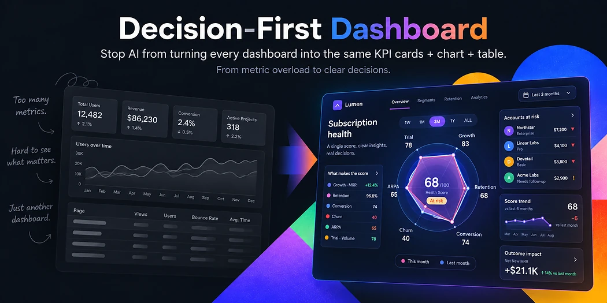
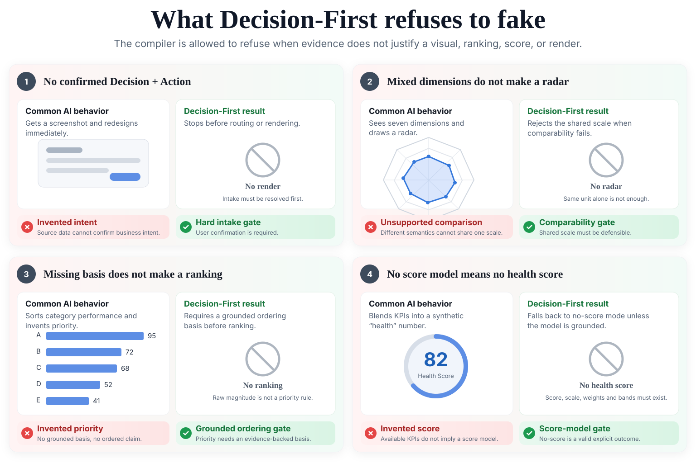
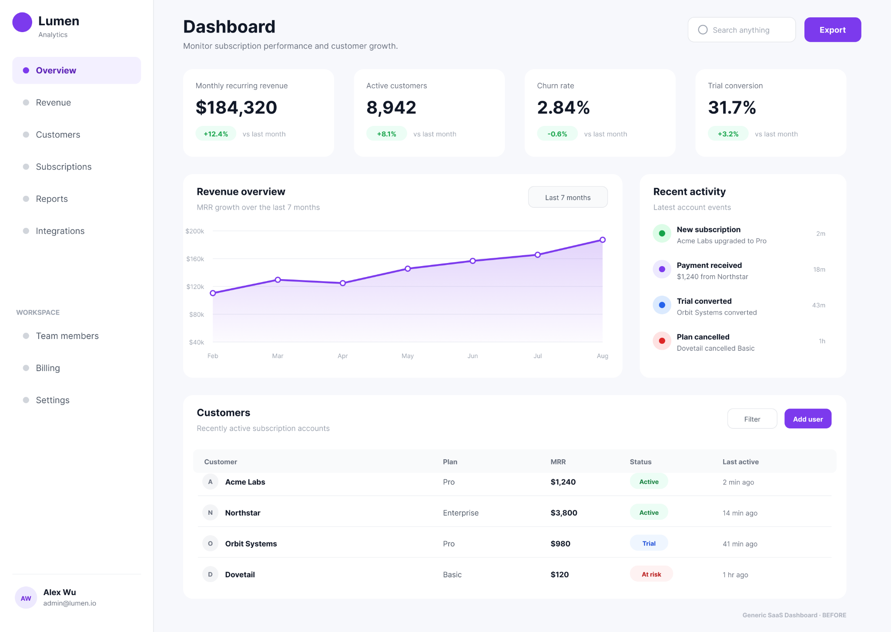
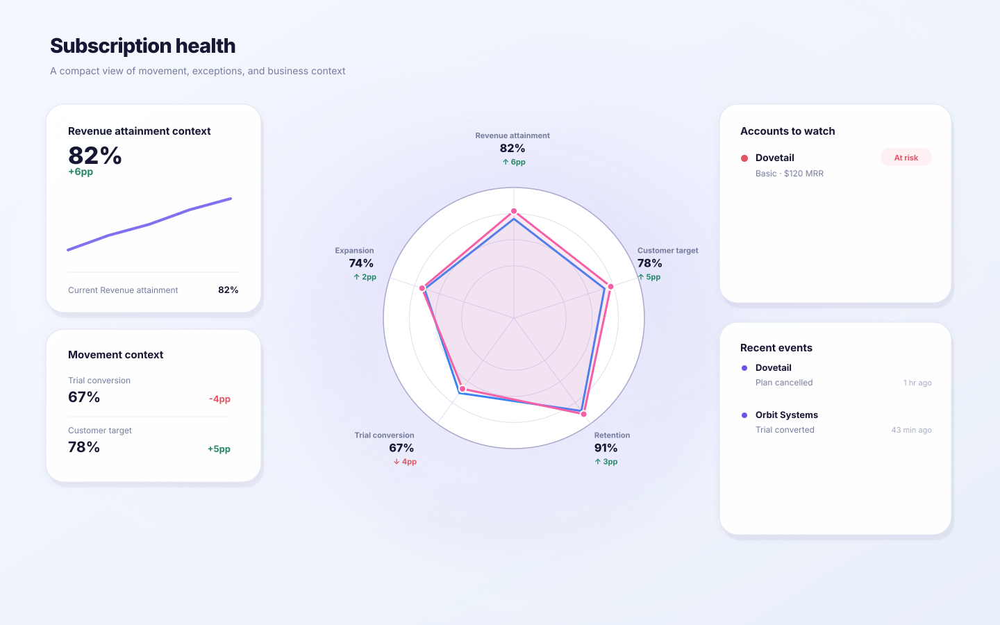

<p align="center">
  
</p>

# Decision-First

<p align="center">
  <a href="https://github.com/fourleaf13-hue/decision-first-dashboard/actions/workflows/compiler-tests.yml"></a>
  <a href="https://github.com/fourleaf13-hue/decision-first-dashboard/blob/main/LICENSE"></a>
  <a href="https://github.com/fourleaf13-hue/decision-first-dashboard/releases"></a>
  <a href="https://skills.sh/fourleaf13-hue/decision-first-dashboard"></a>
</p>

<p align="center">
  Install: <code>npx skills add fourleaf13-hue/decision-first-dashboard</code>
  · <a href="#install">Quick start</a>
  · <a href="CONTRIBUTING.md">Contributing</a>
  · <a href="SECURITY.md">Security</a>
</p>

## AI can generate a dashboard. Decision-First governs what deserves to become one.

A source can contain **70 valid KPIs without becoming a 70-KPI dashboard**.

Decision-First is a rule-driven system for turning messy analytical inputs into decision-oriented dashboard artifacts while preserving provenance, enforcing semantic and structural constraints, and refusing outputs that cannot pass its current evidence and rendering gates.

> **Preserve everything without showing everything.**

Most AI dashboard tools optimize for getting from data to a polished interface faster.

Decision-First starts earlier:

> **Does this need to be a dashboard at all?**

If it does, the user must confirm the **Decision** and **Action** during intake before routing or rendering can continue.

The dashboard is then built around what can actually change that decision — not around everything that happens to exist in the dataset.

## Try it in 60 seconds

```bash
npx skills add fourleaf13-hue/decision-first-dashboard
```

Then give your agent a dashboard screenshot, Figma frame, existing dashboard code, or verified metrics and try one of these:

**Existing dashboard**

> Review this dashboard. First decide whether it should be a dashboard at all. If yes, ask only what you need to confirm the Decision and Action before redesigning it.

**KPI-heavy dashboard**

> Redesign this KPI-heavy dashboard around the decision it needs to support. Preserve the evidence, but do not invent scores, rankings, thresholds, or unsupported conclusions.

**Power BI / Tableau screenshot**

> Audit this dashboard for decision relevance, KPI overload, unsupported visual semantics, and what should actually remain in the first view.

---

## What goes in

Decision-First can work from inputs such as:

- dashboard screenshots;
- Figma frames;
- existing dashboard code;
- structured or normalized analytical data;
- source-backed evidence extracted from other material.

The user confirms the intended **Decision** and **Action** during intake.

The system then determines:

- whether a persistent dashboard is warranted;
- which metrics are decision-relevant;
- which evidence belongs in the first view;
- which context must remain available for diagnosis or drilldown;
- which visual structures are semantically legal;
- and whether the final artifact matches the approved compiler output.

It is designed to work alongside AI-assisted generation, but the governing rules are separate from the generative model.

---

## What it governs

Decision-First does not begin with:

> **What can we visualize?**

It begins with:

> **What must the user understand in order to make or support this decision?**

That changes the role of the dashboard.

The source may contain dozens of valid metrics, dimensions, exceptions, relationships, and candidate views.

Decision-First preserves that analytical inventory without assuming that all of it belongs on screen.

A metric earns first-view space because it changes the decision, exposes an active exception, or provides necessary diagnostic context — not simply because it exists.

> **Preserve everything without showing everything.**

---

## Authority → Enforcement → Verification

### Authority

The user confirms the intended **Decision** and **Action** during intake.

The system then establishes the allowed metric roles, semantic structures, evidence bindings, and presentation constraints that downstream rendering must respect.

A screenshot or dataset may suggest intent.

It does not silently confirm business intent.

### Enforcement

The compiler applies those rules to the available evidence and fails closed when required support is missing.

Examples:

- no confirmed Decision + Action → no routing;
- no grounded ordering basis → no invented priority ranking;
- incomparable dimensions → no unsupported shared-scale comparison;
- no defensible composite score model → no invented health score;
- unresolved semantic intent → ask instead of freestyle.

Decision-First prefers a visible refusal or clarification over a polished artifact that implies more certainty than the evidence supports.

### Verification

The final artifact is checked against the compiler's declared output contract rather than being accepted because it looks correct.

Canonical HTML/SVG, semantic delivery state, provenance, and the compiler's delivery record are cross-checked so divergence between the approved structure and the delivered file can be detected.

**Verification proves that the delivered artifact is faithful to the inputs and contract it was given. It does not prove that the upstream inputs themselves are correct.**

Source-backed claims are tied to explicit evidence anchors, and canonical outputs carry machine-verifiable provenance.

---

## What Decision-First refuses to fake

Decision-First is intentionally allowed to say **no**.

<p align="center">
  
</p>

| Input or request | Decision-First response |
| --- | --- |
| No confirmed Decision + Action | **No render** — intake must be resolved first |
| Seven mixed or incomparable dimensions | **No radar** — shared-scale comparability must be defensible |
| No grounded ordering basis | **No invented ranking** — ask for or recover a supported basis |
| No defensible composite score model | **No health score** — fall back to a no-score representation |

If a visual encoding cannot be defended from the available evidence and semantic contract, it should not be produced merely because the chart type is available.

### Seven dimensions do not automatically justify a radar chart

A radar profile is allowed only when the dimensions are genuinely comparable on a defensible shared scale.

Mixed-unit raw KPIs are not forced into one.

### A ranking requires a grounded basis

If the dashboard is supposed to prioritize candidates, the ordering must come from grounded rank evidence or another supported ordering basis.

Decision-First does not invent a ranking just because a list exists.

### A score requires a real score model

A composite score is allowed only when the source provides the required score model facts, including the score, scale, components, normalization, weighting, aggregation, and bands.

Otherwise the system falls back to a no-score representation.

This is the core difference between generation and governance:

**Generation asks what can be produced.**  
**Governance asks what can be defended.**

---

## Sometimes the right dashboard is no dashboard

Not every analytical problem deserves a persistent dashboard.

A dashboard should support a recurring decision or monitoring loop, have an accountability path, and change some response when an important signal changes.

That response may involve:

- action;
- priority;
- escalation;
- intervention;
- coordination.

“Visibility” alone is not enough.

Some problems are better served by:

- a one-off analysis;
- a scheduled summary;
- an alert;
- a report;
- a query or chat workflow.

Decision-First can redirect to those formats when a persistent dashboard is not warranted.

**Today, that path redirects the workflow; Decision-First does not generate the replacement artifact itself.**

---

## A 3 / 10 / 30-second reading heuristic

Most dashboards are optimized for reporting, not decisions.

The showcase was redesigned around a simple reading heuristic:

- **3 seconds** — see what needs attention;
- **10 seconds** — understand why it matters;
- **30 seconds** — reach enough supporting evidence to decide where to look or act next.

This is a design heuristic for the showcase, not a substitute for the compiler's hard gates.

> **What matters → Why → What should I do?**

---

## Before → After

**Before:** dozens of metrics competing for attention.

**After:** the minimum sufficient decision signals, the reason they matter, and the evidence needed to investigate further.

<table>
  <tr>
    <th width="50%">Before</th>
    <th width="50%">Decision-First After</th>
  </tr>
  <tr>
    <td width="50%"></td>
    <td width="50%"></td>
  </tr>
</table>

The After example uses source-backed percentage dimensions on one defensible 0–100 scale.

If the dimensions were not comparable, the radar would not be allowed.

---

## What is enforced today

Current production contracts include:

- dashboard worthiness assessment before dashboard generation;
- explicit user-confirmed Decision and Action before routing;
- metric routing bound to that confirmed intent;
- preservation of the complete metric inventory while limiting first-view exposure;
- grounded requirements for supported ranking behavior;
- semantic node typing and presentation eligibility;
- temporal vs categorical axis semantics;
- comparability requirements for shared position, length, area, and scale;
- no unsupported composite score;
- exact source anchoring for source-backed claims;
- source file hashing and evidence binding;
- deterministic compiler-owned HTML/SVG output;
- canonical provenance;
- delivered artifact checks against the compiler's delivery state.

Some areas are still being hardened.

In particular, stronger production enforcement for **evaluative business language** — for example claims such as “healthy,” “poor,” “most important,” or “needs attention” when those judgments are not themselves grounded — remains an active boundary rather than a solved problem.

The repository deliberately distinguishes between:

**implemented**  
**tested**  
**expected-negative / still being hardened**

Those are not treated as the same thing.

---

## What's tested

Decision-First is tested against both successful compilation and refusal behavior.

The current repository test suite includes contracts around:

- Dashboard Worthiness transitions;
- ambiguous-intent intake behavior;
- Decision + Action confirmation;
- large metric inventories;
- metric routing;
- no-score and composite compilation;
- evidence grounding;
- semantic node rendering;
- radar eligibility;
- comparability and scale behavior;
- canonical provenance;
- delivered HTML/SVG verification;
- byte-level golden snapshots;
- runtime skill provenance;
- standalone skill packaging.

The repository also maintains an **expected-negative lane** for contracts that are intentionally visible but not yet productionized.

```bash
npm run test:red-lane
```

Those tests document known boundaries instead of hiding them.

Repository tests establish specific contracts and regressions.

**They are not proof that every dashboard domain, every source type, or every live model invocation will generalize correctly.**

---

## How it works

The production path is intentionally staged.

```text
User context
↓
Worthiness Assessment
↓
worthiness gate
↓
Decision Brief
↓
intake gate
↓
evidence extraction
↓
Metric Router
↓
grounded decision state
↓
semantic composition
↓
routing + grounding checks
↓
deterministic renderer
↓
canonical HTML / SVG + output.manifest.json
↓
delivered-artifact verification
```

The agent does not own the final visual output.

The compiler does.

---

## Dashboard Worthiness

Before asking how to render a dashboard, Decision-First asks whether a persistent dashboard is justified. The executable assessment is validated against `schemas/worthiness-assessment.schema.json`.

The assessment records:

- whether there is a recurring decision or monitoring loop;
- whether there is a real accountability path;
- whether changing signals lead to a meaningful response;
- whether the task is better served by another format.

Possible transitions include:

```text
BUILD_DECISION_BRIEF
ASK_WORTHINESS_QUESTION
REDIRECT_NON_DASHBOARD
FIX_WORTHINESS_ASSESSMENT
```

A dashboard is not the default just because data exists.

---

## Decision intake

The **adaptive Decision Brief** captures the user's intended Decision and Action before the **Metric Router** is allowed to run.

Both must be explicitly confirmed before routing is allowed.

```text
ALLOW_ROUTING
ASK_DECISION_BRIEF_QUESTION
FIX_DECISION_BRIEF
```

An inferred Decision or Action is not equivalent to confirmation.

The system asks only as many questions as needed, within a shared intake budget.

---

## Metric routing

Metrics are not treated as equal peers.

They may be routed as:

```text
primary_signal
diagnostic
exception
drilldown
scorecard_only
```

The first view keeps the minimum sufficient decision signals plus active exceptions.

Everything else remains available for diagnosis, drilldown, or traceability.

A source can contain 70 valid KPIs without becoming a 70-KPI dashboard.

---

## Semantic Visual Grammar

Decision context and visual representation are separate stages.

```text
Semantic Node
→ presentation eligibility
→ comparability
→ layout eligibility
→ Internal Visual Spec
→ deterministic renderer
→ delivered verifier
```

Current semantic node types include:

```text
MetricCluster
Trend
Distribution
Breakdown
Ranking
Relationship
ExceptionList
Drilldown
```

Trend is not treated as Distribution.

A recurring calendar bucket is not automatically treated as a temporal trajectory.

Shared visual encodings require compatible semantic and comparability contracts.

Same unit alone is not enough.

---

## Two evidence modes

### No-score mode — no unsupported score invented

If the source does not contain a defensible composite score model, Decision-First does not invent one.

It can still show:

- important signals;
- changes;
- exceptions;
- comparisons;
- distributions;
- rankings;
- a real radar profile when the dimensions are genuinely comparable.

### Composite mode — when the evidence supports it

If the source provides a real composite model — including the required score, scale, normalized components, weights, aggregation rule, and score bands — Decision-First can preserve and display it.

If those facts are missing, the system falls back to `no_score`. A composite-mode reference is available at `examples/saas/composite-mode.png`; the no-score radar reference is `examples/radar-profile/output.no-score.svg`.

---

## Canonical output

When file generation is available, HTML is the primary user-facing deliverable.

The compiler writes:

```text
output.no-score.html
output.composite.html
output.no-score.svg
output.composite.svg
output.manifest.json
```

The SVG is useful for static preview, review, and regression testing.

The HTML is the primary interactive artifact.

A second agent-authored HTML, SVG, image, React app, or other artifact is not the canonical Decision-First output merely because it looks better.

Canonical output comes from the compiler-owned path.

---

## Install

```bash
npx skills add fourleaf13-hue/decision-first-dashboard
```

### Claude workspace — Upload Skill

For Claude's **Skills → Upload skill** flow, use the dedicated `decision-first-dashboard-skill` artifact from the latest successful Compiler Tests run.

The artifact is packaged with `SKILL.md` at the ZIP root and without the repository-level plugin manifest.

Do not use GitHub's **Download ZIP** repository archive as the standalone Claude Upload Skill package.

The repository is also packaged separately as a Claude plugin.

---

## Use

Give your agent a dashboard screenshot, Figma frame, existing dashboard code, or verified metrics and ask:

> Redesign this dashboard using the `decision-first-dashboard` skill.

An ambiguous request such as:

> “Redesign this dashboard.”

is **not render permission**.

The source may establish facts.

It cannot silently confirm the user's Decision or Action.

If intent is unresolved, the system asks before rendering.

---

## Development

```bash
npm test
npm run test:red-lane
npm run package:claude-skill
npm run validate:saas
npm run render:saas
npm run validate:radar-showcase
npm run render:radar-showcase
```

`npm test` is the default production contract suite and should remain green.

The red lane records expected-negative contracts that are deliberately not yet productionized.

---

## Trust boundary

Decision-First separates three integrity layers:

1. **Compiler integrity — hard-enforced.** Once the canonical compiler is invoked, its required worthiness, intake, routing, grounding, semantic, rendering, and delivered-verification gates must pass.
2. **Artifact integrity — verifier-enforced.** Canonical HTML/SVG and `output.manifest.json` must carry the expected provenance and delivery state.
3. **Agent invocation compliance — not runtime-enforced.** Repository tests prove compiler and artifact integrity; they **do not prove that an unconstrained agent actually invoked the canonical compiler** instead of bypassing it with a separate artifact.

This does not prove that the agent or model followed the intended invocation path; it proves the behavior of the governed path when that path is actually used.

It does **not** claim that:

- every upstream source is factually correct;
- every source is authoritative simply because it is available;
- every business judgment can already be validated automatically;
- an unconstrained external agent can never bypass the intended compiler path;
- every dashboard domain has been proven to generalize.

Those boundaries are part of the product contract, not footnotes to hide.

### Runtime Skill provenance gate

Formal acceptance can run through `npm run run:acceptance`, which checks that the runtime is bound to the intended Skill package rather than a stale copied install. Runtime provenance is independent of dashboard semantics: logs, caches, and temp files must remain outside the package.

---

## What this is not

Decision-First is not:

- a generic chart library;
- a prompt for making admin dashboards prettier;
- a guarantee that all source data is correct;
- a replacement for business ownership or domain judgment;
- a system that turns every dataset into a dashboard.

It is a decision-first compiler and governance layer for dashboard artifacts that need stronger control over:

**what deserves to appear, what the evidence supports, how meaning is encoded, and whether the delivered artifact obeys the declared contract.**

---

## The principle

**AI can generate. Decision-First governs.**

The system preserves the analytical evidence base while exposing only what the decision requires.

> **Preserve everything without showing everything.**

## License

MIT